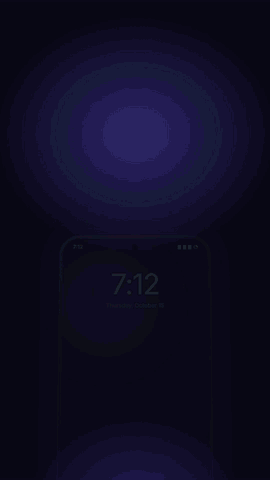

# Mingui

A daily habit checklist with a little buddy, that keeps your distracting apps locked until today's routine is done.

<p align="center"></p>

- **Checklist** with timers, weekday schedules, rest days, streak freezes and partial credit.
- **Honest edits:** changes that would make today's unfinished routine easier start tomorrow (unless you choose to apply them today).
- **App blocking:** pick apps (YouTube, Instagram…) that stay locked until you've ticked everything off.
- **Focus lock** (optional): pulls you back to the checklist if you wander off, with 3 five-minute breaks a day and a "Pause for today" emergency exit.
- **A buddy** that walks around your screen, cheers you on and collects accessories as your streak grows.
- **Stats:** streaks, a 12-week heatmap, the habits that need some love.
- **Home-screen widget**, backups to a file, and English, Spanish and Catalan.

## 100% offline

Mingui doesn't request Android's internet permission, so it can't send anything anywhere. There are no accounts, ads, analytics or trackers. Everything stays on your phone. See the [privacy policy](https://abysstudio.github.io/mingui/privacy/).

## Two versions

| | Package | How it blocks apps | Where |
|---|---|---|---|
| **Mingui** | `io.github.abysstudio.mingui` | Covers a blocked app with your checklist (Usage access + Display over other apps) | Google Play |
| **Mingui Root** | `io.github.abysstudio.mingui.root` | Hides blocked apps completely with root (`pm hide`) | [GitHub Releases](https://github.com/abysstudio/mingui/releases) |

They can be installed side by side. The Play version contains no root code at all.

## Building

No Gradle: a small shell script drives the Android SDK tools directly.

Requirements: JDK 17, Android SDK with `platforms;android-36` and `build-tools;36.0.0`.
For the Play bundle also [bundletool](https://github.com/google/bundletool) and the standalone `aapt2` from Google Maven, in a `TOOLS` folder.

```sh
SDK=/path/to/sdk ./build.sh                        # mingui.apk       (Play version, for testing)
SDK=/path/to/sdk ./build.sh root                   # mingui-root.apk
SDK=/path/to/sdk TOOLS=/path/to/tools ./build.sh play aab   # mingui.aab (signed with signing/upload.jks)
```

APKs are signed with a local `debug.keystore` (created on first build). The version lives in `version.properties`.

### Buddy accessories

Accessories are data, not code: see [`res/raw/accessories.json`](res/raw/accessories.json). Shapes (circles, lines, rectangles, arcs, SVG paths), colours, names in each language and unlock rules (a streak, or a date for seasonal ones) are all described there.

## Translations

`res/values/strings.xml` (English), `res/values-es/` (Spanish) and `res/values-ca/` (Catalan). New languages are welcome; also add them to `res/xml/locales_config.xml`.

## License

[GPL-3.0](LICENSE). © 2026 Abyss Studio.
