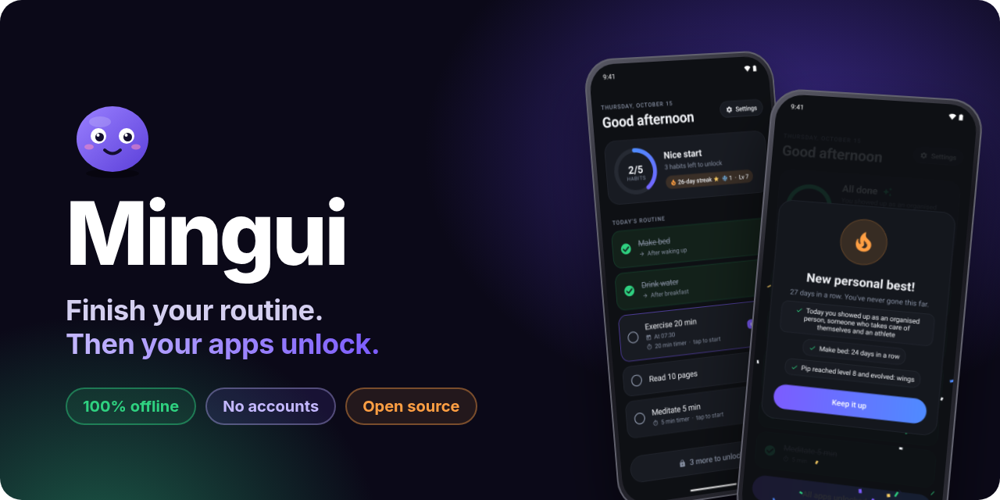
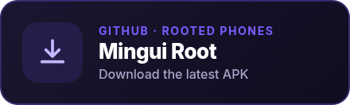
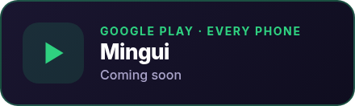
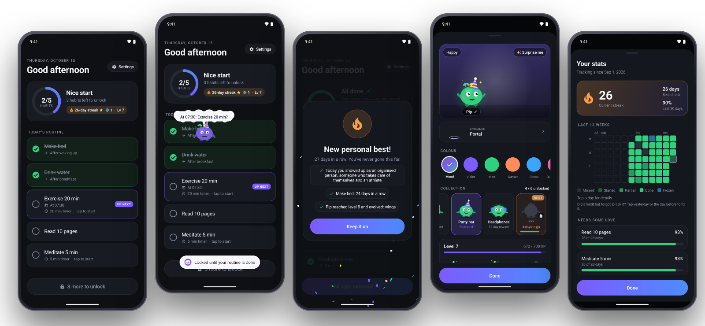

<p align="center">
  
</p>

<p align="center">
  <a href="https://github.com/abysstudio/mingui/releases/latest"></a>
  
  
  
  <a href="LICENSE"></a>
</p>

<p align="center">
  <b>A daily habit checklist with a little buddy, that keeps your distracting apps locked until today's routine is done.</b>
</p>

<p align="center">
  <a href="https://github.com/abysstudio/mingui/releases/latest"></a>
  &nbsp;
  <a href="https://abysstudio.github.io/mingui/"></a>
</p>

<p align="center">
  <a href="https://abysstudio.github.io/mingui/">Website</a> ·
  <a href="https://abysstudio.github.io/mingui/privacy/">Privacy</a> ·
  <a href="https://github.com/abysstudio/mingui/releases">Releases</a> ·
  <a href="https://github.com/abysstudio/mingui/issues">Report a bug</a>
</p>

---

## Why Mingui

You reach for your phone at 7am, open YouTube "for a minute", and the morning is gone. Mingui flips the order: **the habits come first, the scrolling comes after.** Pick the apps that eat your mornings; they stay locked until today's checklist is ticked off, then unlock on their own.

<table>
<tr>
<td width="50%" valign="top">

### How it works

1. **Build your routine.** Make bed, drink water, 20 minutes of exercise… with timers, cues and weekday schedules.
2. **Pick the apps to hold back.** YouTube, Instagram, games: whatever pulls you in.
3. **Open one too early** and your checklist covers it, with your buddy cheering you on.
4. **Tick the last habit** and everything unlocks for the rest of the day.

</td>
<td width="50%" align="center">

</td>
</tr>
</table>

<p align="center">
  
</p>

## Features

| | |
|---|---|
| ✅ **A checklist that sticks** | Timers for habits you want to really do, weekday schedules, rest days, partial credit and streak freezes. Forgot to tick something? Fix yesterday. |
| 🔒 **Apps unlock when you're done** | Blocked apps are covered by your checklist until today's routine is complete. Allowed apps (your work tools) always get through. |
| 🤝 **Honest edits** | Changes that would make today's unfinished routine easier start tomorrow. Applying them today takes a deliberate 3-second hold. |
| 🟣 **A buddy on your screen** | It walks around your phone, climbs out of portals, cheers you on and levels up with you: sprout, glow, then wings. |
| 🎨 **Personalize** | Colours, hats and entrance styles that unlock as your streak grows. Size, speed and chattiness are up to you. |
| 📈 **Streaks & stats** | A 12-week heatmap, your best streak and the habits that need some love. |
| 🎯 **Focus lock (optional)** | Pulls you back to the checklist if you wander off, with three 5-minute breaks a day. |
| 🆘 **Always an exit** | "Pause for today" turns blocking off until tomorrow when life happens. |
| 🧩 **And more** | Home-screen widget, backups to a file you keep, English, Spanish and Catalan. |

## Your data stays on your phone

Mingui **doesn't request Android's internet permission**, so it physically can't send anything anywhere. You can check: "full network access" isn't in its permission list.

- No accounts or sign-up
- No ads, analytics, crash reporting or trackers
- No third-party SDKs
- Uninstalling deletes everything

Read the full [privacy policy](https://abysstudio.github.io/mingui/privacy/).

## Two versions

Same app, same buddy. Pick the one that fits your phone; they can even live side by side.

| | **Mingui** | **Mingui Root** |
|---|---|---|
| For | Every phone | Rooted phones |
| How it blocks | Covers a blocked app with your checklist | Hides blocked apps completely (`pm hide`) until you're done |
| Permissions | Usage access + Display over other apps, asked only when a feature needs them | Granted by root |
| Package | `io.github.abysstudio.mingui` | `io.github.abysstudio.mingui.root` |
| Get it | Google Play (coming soon) | [GitHub Releases](https://github.com/abysstudio/mingui/releases/latest) |

The Play version contains no root code at all.

## FAQ

<details>
<summary><b>Can't I just uninstall Mingui or turn it off?</b></summary>

Yes, and that's on purpose: Mingui is a nudge, not a prison. It makes "habits first" the default, and getting out of it takes a deliberate step ("Pause for today" or a 3-second hold), which is usually enough to stop the autopilot scroll.
</details>

<details>
<summary><b>What if a habit is wrong for today?</b></summary>

Edit it. Changes that don't make today easier (renaming, adding, making something harder) apply straight away. Changes that would make today easier (removing an unticked habit, shortening a timer, moving it off today) start tomorrow, unless you hold to apply them today.
</details>

<details>
<summary><b>Does it work at night?</b></summary>

The routine day starts at 4am, so a late night still counts as the previous day.
</details>

<details>
<summary><b>Will updates keep my habits and streak?</b></summary>

Yes. Every Mingui Root release installs over the previous one and keeps your data, including builds from before 1.7.8, when it moved to its own release key. To move between phones, use Export backup in Settings.
</details>

## Building

No Gradle: a small shell script drives the Android SDK tools directly.

Requirements: JDK 17, Android SDK with `platforms;android-36` and `build-tools;36.0.0`. For the Play bundle also [bundletool](https://github.com/google/bundletool) and the standalone `aapt2` from Google Maven, in a `TOOLS` folder.

```sh
SDK=/path/to/sdk ./build.sh                                 # mingui.apk       (Play version, for testing)
SDK=/path/to/sdk ./build.sh root                            # mingui-root.apk
SDK=/path/to/sdk TOOLS=/path/to/tools ./build.sh play aab   # mingui.aab       (signed with signing/upload.jks)
```

APKs are signed with a local `debug.keystore` (created on first build); Mingui Root uses `signing/root-release.jks` when present. The version lives in `version.properties`.

<details>
<summary><b>Project layout</b></summary>

| Path | What |
|---|---|
| `src/` | The app (plain Java, no libraries) |
| `res/raw/accessories.json` | Buddy accessories as data: shapes, colours, names per language, unlock rules |
| `variants/` | Code that differs between the Play and Root builds |
| `docs/` | The website and privacy policy (GitHub Pages) |
| `store/` | Play Store screenshots and listing text ([`store/PLAY.md`](store/PLAY.md)) |
| `promo/` | The promo video, written as code ([`promo.html`](promo/promo.html)) and rendered frame by frame |
| `.github/assets/` | README artwork, rendered by [`make.py`](.github/assets/make.py) |
</details>

## Translations

English (`res/values/`), Spanish (`res/values-es/`) and Catalan (`res/values-ca/`). New languages are very welcome: copy `res/values/strings.xml`, translate, add the locale to `res/xml/locales_config.xml` and open a pull request.

## Contributing

Bug reports and ideas are welcome in [Issues](https://github.com/abysstudio/mingui/issues). If Mingui crashes, reopen it and tap **Share report** on the crash screen: the report is saved on your phone and only leaves it if you send it.

## License

[GPL-3.0](LICENSE) © 2026 Abyss Studio.

<p align="center">
  
  <br><sub>Made with care, and no trackers.</sub>
</p>
